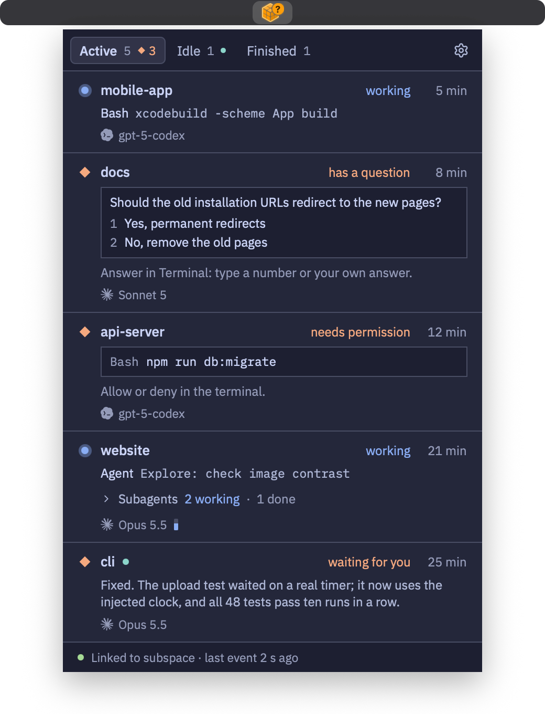
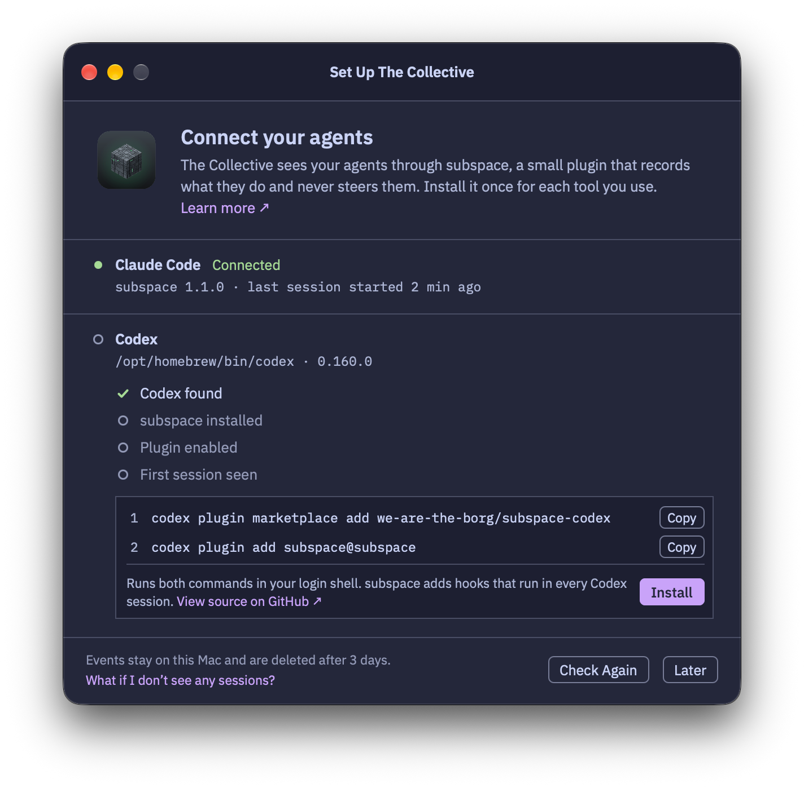
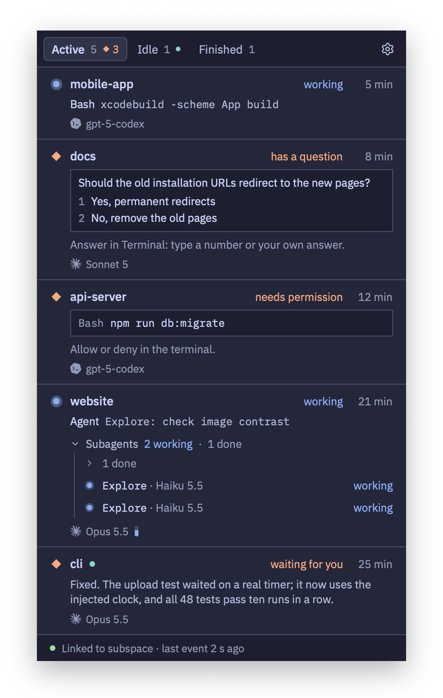
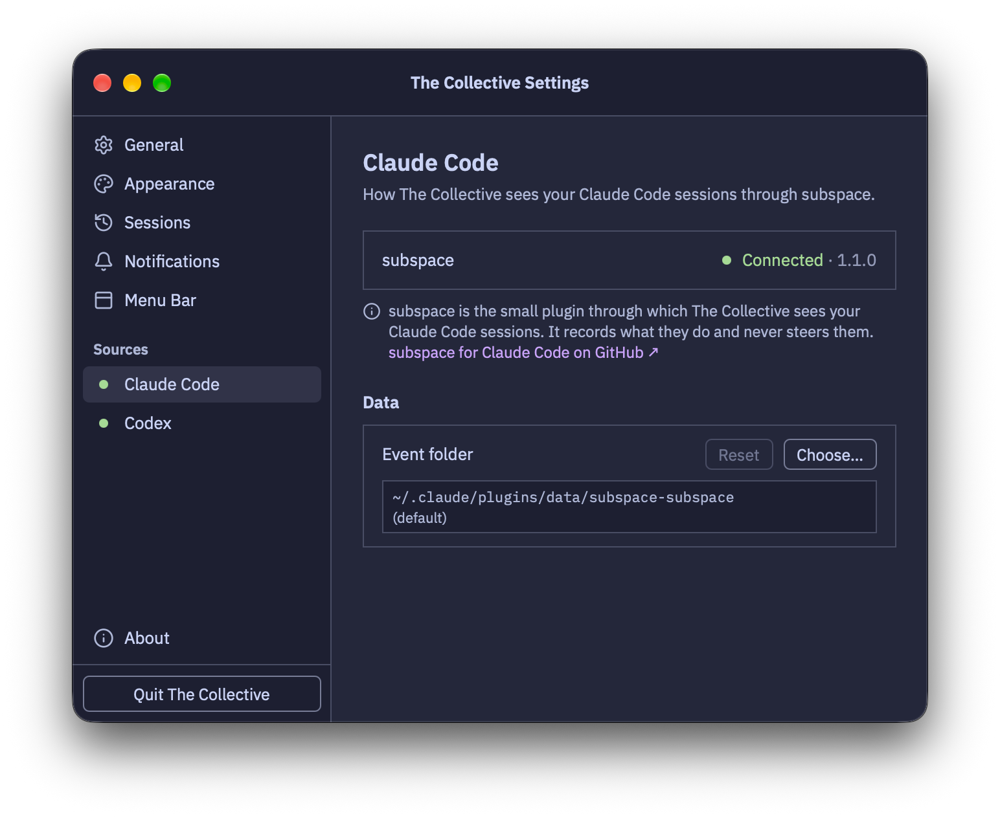
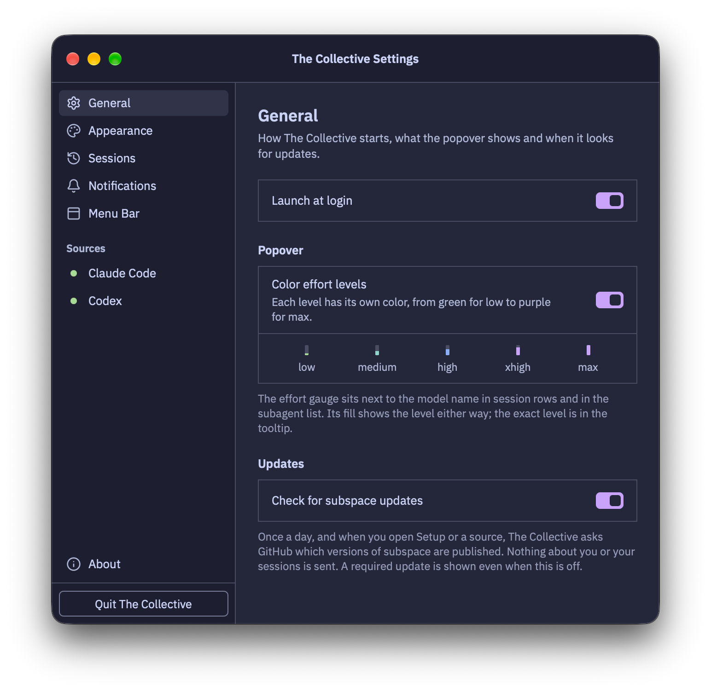
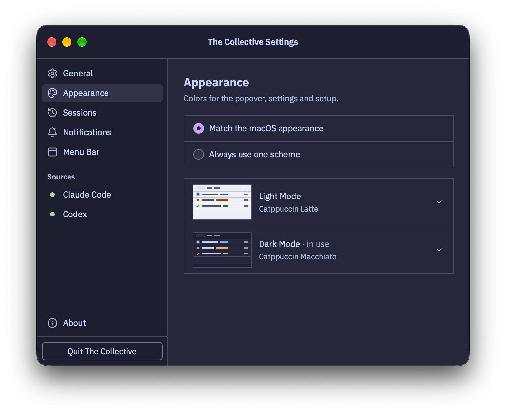
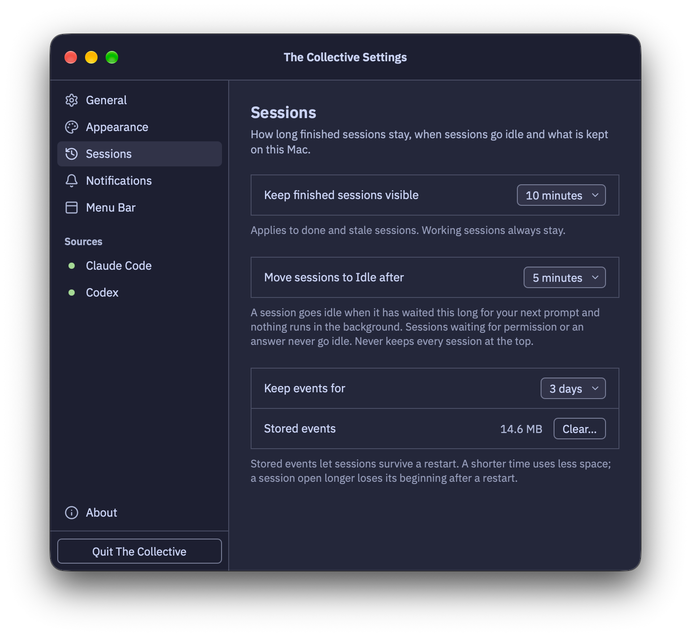
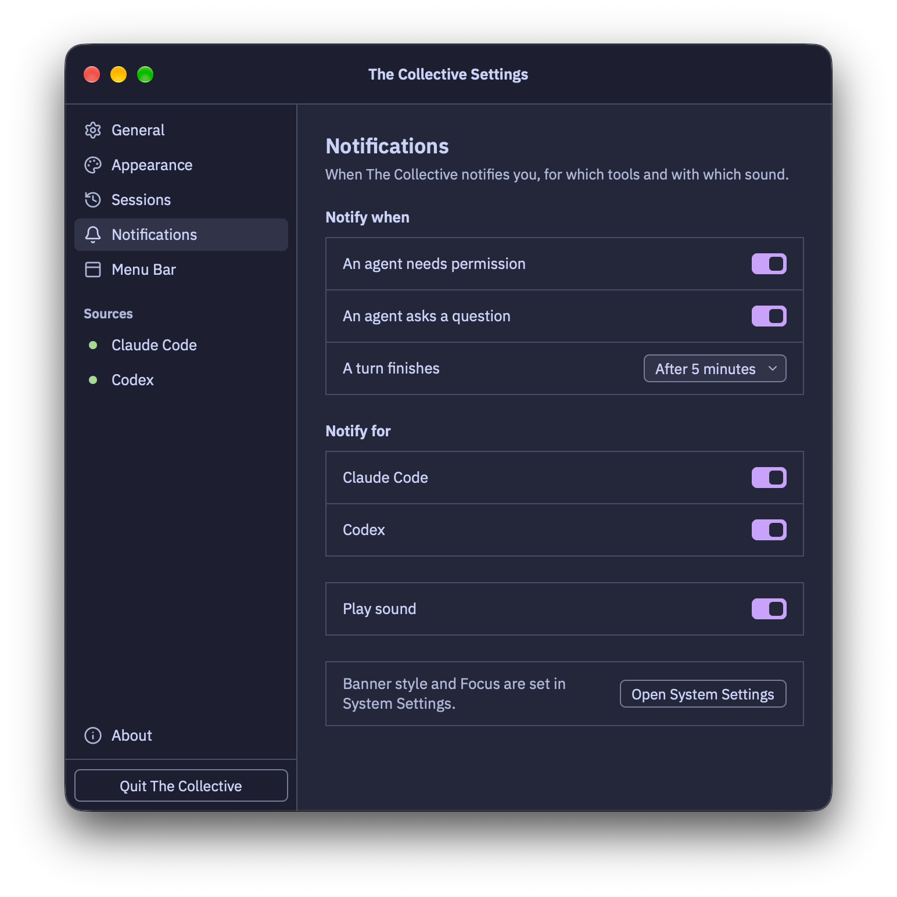
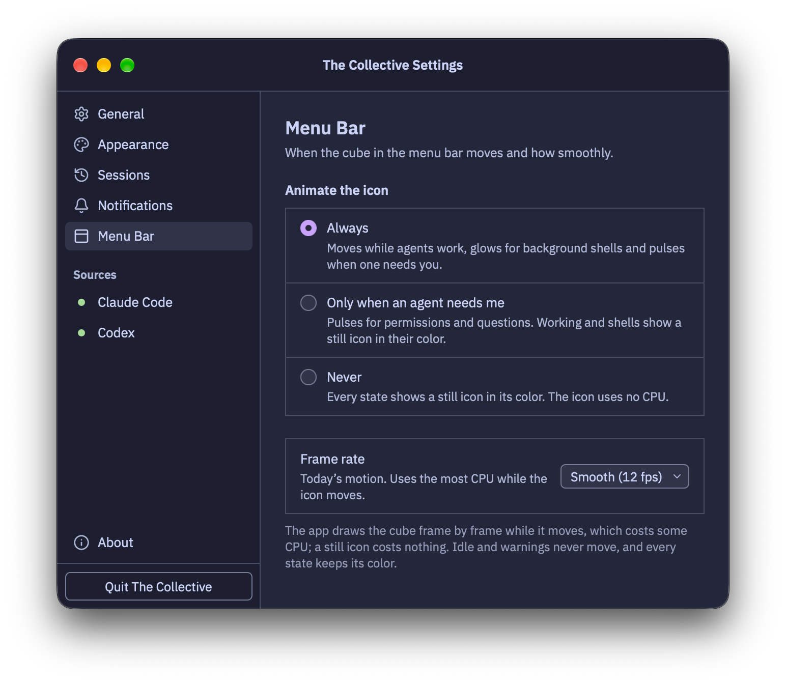
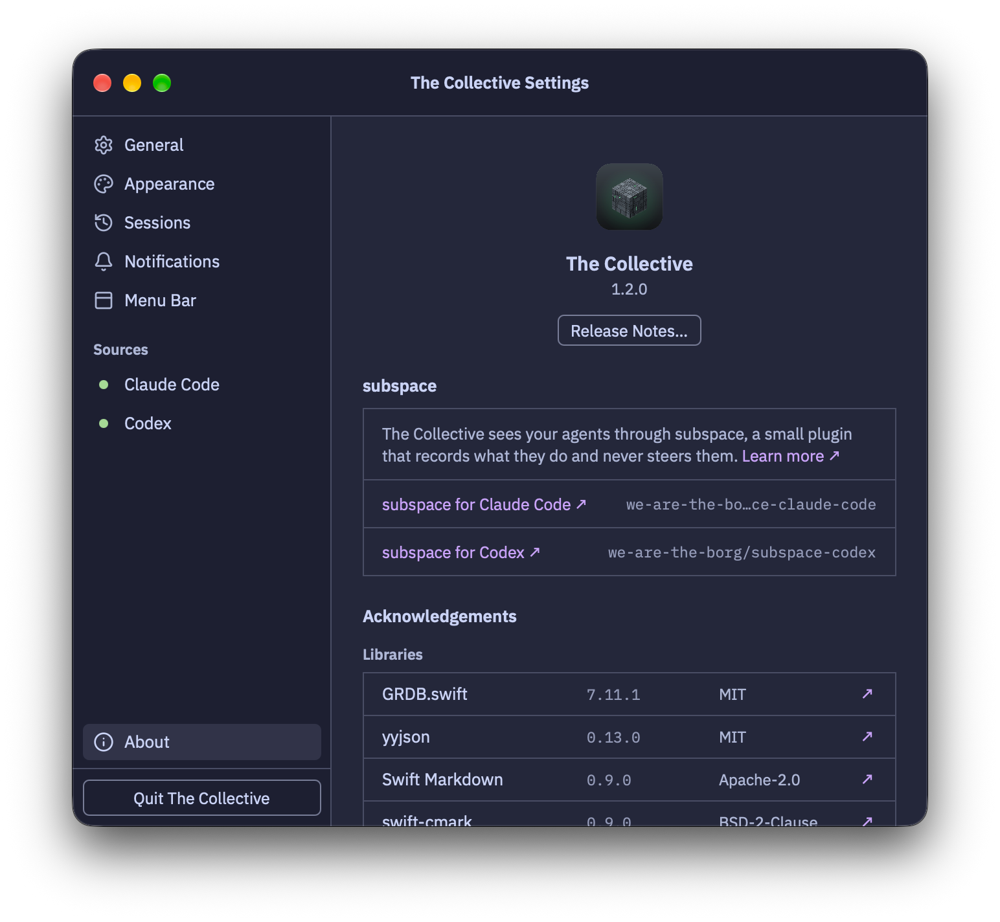

# The Collective

The Collective is a macOS menu bar app for monitoring AI coding agents. It tracks running Claude Code and Codex sessions, including subagents, and shows when a session needs attention.

The popover provides details for each session, including its prompt, model, current tool and runtime.



The menu bar icon shows how many agents are working and turns amber when one needs you:


The app uses [subspace](https://github.com/we-are-the-borg/subspace), a shared, observe-only plugin that collects hook events without interfering with the agents.

Claude Code and Codex are supported. Additional tools can be integrated through source adapters.

## Requirements

- macOS 15 or later
- Claude Code, Codex or both
- The subspace plugin for each tool you use. The setup window installs it for you.

## Installation

1. Download the latest release (`The-Collective-<version>.zip`) from this repository's Releases page.
2. Unzip it and move `The Collective.app` to `/Applications`.
3. Open the app.

## Setup

On first launch, once the first check has finished, the setup window opens if subspace is missing or switched off for the tools it found. It shows one section for each tool. It checks whether the tool is on your Mac and whether subspace is installed and enabled, and it shows the commands that connect the tool. Each command can be copied, and the section's button runs the commands for you. The window then waits for the first session to start and shows "Connected" once it has seen one. "Set Up…" reopens it later: in a tool's pane in Settings whenever that tool isn't connected, and in the menu bar icon's menu and the popover's warning while the warning shows (subspace missing or switched off).



If you prefer the terminal, these are the commands.

**Claude Code**

```sh
claude plugin marketplace add we-are-the-borg/subspace-claude-code
claude plugin install subspace@subspace --scope user
claude plugin enable subspace@subspace
```

**Codex**

```sh
codex plugin marketplace add we-are-the-borg/subspace-codex
codex plugin add subspace@subspace
```

Then start a new session in the tool. Codex holds the plugin's hooks back until you approve them with `/hooks` in that session.

## Screenshots

| | |
|---|---|
|  |  |
|  |  |
|  |  |
|  |  |

## FAQ

### AI usage

Surprise, this is a tool to monitor AI agents, so I obviously wrote it using AI (Claude Code in my case, mostly Opus 5.5). I test and review everything on my Mac though. Never trust Open Source projects no one knows, and if you like to, build the app in Xcode yourself. Remember that you need an active Apple Developer account, to sign the app and use it without annoying side effects. 

### What if I don't see any sessions?

If the menu bar icon shows a warning, subspace may be missing or disabled.

Otherwise, check the following:

**subspace isn't installed or enabled.**

Install and enable the Claude Code plugin:

```sh
claude plugin marketplace add we-are-the-borg/subspace-claude-code
claude plugin install subspace@subspace --scope user
claude plugin enable subspace@subspace
```

You can also manage the plugin through `/plugin` inside Claude Code. Restart your sessions afterward.

**The session started before subspace was installed.**

Start a new session. Existing sessions won't pick up newly installed hooks.

**subspace was updated, but the session is still running.**

Claude Code loads plugin updates when a new session starts.

**Hooks are disabled.**

Check whether `disableAllHooks` is set in Claude Code or enforced by a managed policy. When hooks are disabled, subspace can't record events.

**The app and agent use different event directories.**

This can happen when Claude Code runs with a custom `CLAUDE_CONFIG_DIR` or `SUBSPACE_DIR`, but The Collective doesn't inherit those variables.

Apps launched from Finder or the Dock don't inherit your shell environment.

By default, The Collective reads events from:

```text
~/.claude/plugins/data/subspace-subspace
```

## Development

Build the app and run the package tests from the repository root:

```sh
xcodebuild -project App/Collective.xcodeproj -scheme Collective -configuration Debug CODE_SIGNING_ALLOWED=NO build
(cd CollectiveKit && swift test)
(cd SubspaceKit && swift test)
```

### Releasing

The app version is defined in `App/Version.xcconfig` (`MARKETING_VERSION`). The build number matches the version.

Releases follow SemVer, with version bumps determined by Conventional Commit PR titles. PRs are squash-merged, so the title becomes the commit message on `main`.

- `feat` bumps the minor version.
- `fix` and other types bump the patch version.
- `!` indicates a breaking change and bumps the major version.

`CHANGELOG.md` is generated with git-cliff and includes all commit types. It is intended for developers and included in the GitHub release.

`ReleaseNotes.md` contains the user-facing release notes, written manually, with one `## X.Y.Z` section per version.

#### Prerequisites

- `git-cliff` and `gh` installed (`brew install git-cliff gh`), with GitHub CLI authenticated.
- A Developer ID certificate in the keychain.
- A `notary` keychain profile configured as described under [Building for another Mac](#building-for-another-mac).

#### Release workflow

Every release goes through a pull request. Never commit a release directly to `main`.

**1. Prepare**

On a clean, up-to-date `main`:

```sh
scripts/release.sh prepare
```

The script determines the next version using git-cliff and creates a `release/vX.Y.Z` branch containing:

- The updated version in `App/Version.xcconfig`.
- A new section in `CHANGELOG.md`.
- A new `## X.Y.Z` section in `ReleaseNotes.md`, initially containing a comment as a placeholder.
- A commit named `chore(release): vX.Y.Z`.

It asks before pushing the branch and opening the PR.

If the release notes section already exists, `prepare` preserves it.

In the PR, write the user-facing release notes and review the generated changelog. The app bundles its own copy of the release notes, so keep both files in sync:

```sh
cp ReleaseNotes.md CollectiveKit/Sources/CollectiveKit/Resources/ReleaseNotes.md
```

Commit the changes and squash-merge the PR.

**2. Publish**

After merging, update your local `main` and run:

```sh
scripts/release.sh publish
```

Before building, the script checks that:

- The release notes exist and contain a non-empty section for the current version.
- The bundled release notes match the source file.
- The working tree is clean and `main` matches `origin/main`.

If release notes are missing or contain only comments, publishing stops. Add the notes through a PR before trying again.

The script then:

1. Archives the Release build.
2. Signs it with the Developer ID certificate.
3. Notarizes it with Apple and staples the ticket.
4. Verifies the app with `spctl`.
5. Creates `build/release/vX.Y.Z/The-Collective-X.Y.Z.zip`.

Before publishing, it asks for confirmation to tag the current HEAD as `vX.Y.Z`, push the tag and create the GitHub release.

The GitHub release contains the user-facing notes first, followed by the changelog under `### Changes`. HTML comments are stripped from the release notes.

If commits have landed since the release commit (the last commit changing `App/Version.xcconfig`), the script lists them and asks whether to release the current HEAD anyway.

#### Retrying a release

If `publish` stops after notarization but before tagging, run it again.

The completed build records its commit in:

```text
build/release/vX.Y.Z/notarized-commit
```

The script reuses the existing build when the commit still matches HEAD, the ZIP exists and `spctl` accepts the app. Otherwise, it explains why and rebuilds.

#### Non-interactive runs

Both commands ask before pushing or publishing.

Pass `--yes` or `-y` to accept every prompt:

```sh
scripts/release.sh publish --yes
```

This also accepts the option to release HEAD when additional commits have landed.

Without an interactive terminal or `--yes`, the script aborts rather than assuming an answer.

#### Testing the release script

After changing `scripts/release.sh`, run:

```sh
scripts/test-release.sh
```

This tests the release workflow in a temporary Git repository with a local `origin` and stubs for Xcode, `notarytool`, `spctl` and `gh`.

#### Checking for private data

`scripts/public-check.sh` reports tracked files that carry data the public repository must not have. The planning folder `tasks` and untracked files are skipped. Rules:

- `paths`: home paths with a real name (also JSON-escaped and in Claude Code's encoded project names) and temporary folders
- `private-repo`: references to the private owner's repositories, plugins and ids, except the bundle id
- `plan-refs`: references to planning notes, decision numbers and bare issue numbers of this repository (issues of public repositories such as `we-are-the-borg/subspace` keep theirs)
- `design-ids`: item ids of the design references in the planning folder (a prefix letter and a number), where the references put them: in parentheses, ranges and lists, as board scenarios, as a comment's opening label and after words such as design, board or item (not in `Fixtures/`; capture run names such as subspace uses are allowed in `public-check.allow`)
- `addresses`: e-mail addresses, except placeholders and copyright lines of third-party licenses
- `identity`: the name, login, host name and addresses of whoever runs the check, read at run time from the machine and from the git config and history of the checkout the script lives in (`PUBLIC_CHECK_IDENTITY_EXTRA` adds more, separated by spaces)
- `fixtures`: account identifiers and credentials in test fixtures (`Fixtures/` folders)

Prompts and replies in captured fixtures are not detected automatically. Read them before publishing a capture.

```sh
scripts/public-check.sh             # every finding, then a count per rule
scripts/public-check.sh --summary   # counts only
scripts/public-check.sh --rule paths,addresses
```

It exits with 1 when something is found. Exceptions, each with a reason, are listed in `scripts/public-check.allow`. After changing either file, run `scripts/test-public-check.sh`.

#### Acknowledgements

The About pane's license list and `THIRD_PARTY_NOTICES.md` are generated. Do not edit them manually.

The generated files are:

- `CollectiveKit/Sources/CollectiveKit/Resources/Acknowledgements.json`
- `THIRD_PARTY_NOTICES.md`

After adding, removing or updating a dependency, bundled font, icon set or color scheme, run:

```sh
scripts/acknowledgements.sh
```

Commit both generated files.

The script reads pinned dependencies from `CollectiveKit/Package.resolved` and collects their license and NOTICE files from the package checkouts. It runs `swift package resolve` if the checkouts are missing.

For resources that aren't Swift packages, it reads names, SPDX identifiers, URLs and license files from `CollectiveKit/Acknowledgements/acknowledgements.json`. See the README in that directory for details.

Generation fails if a pinned package has no entry or license text, or if an entry references a package that is no longer pinned.

`swift test` also checks consistency through `AcknowledgementsTests`.

### Building for another Mac

The normal release process is automated. These steps describe how to build and distribute the app manually.

For distribution to another Mac, the app must be signed with a Developer ID certificate and notarized by Apple to pass Gatekeeper without manual intervention.

The target Mac needs macOS 15 or later and subspace installed.

#### One-time setup

1. Create an app-specific password at [account.apple.com](https://account.apple.com) under Sign-In and Security › App-Specific Passwords. Your regular Apple ID password won't work.

2. Store the credentials in the keychain as the `notary` profile. Run this from a regular terminal, since it prompts for the password:

   ```sh
   xcrun notarytool store-credentials notary \
     --apple-id <your Apple ID> \
     --team-id 7WMWDJM5YK
   ```

3. Verify the profile:

   ```sh
   xcrun notarytool history --keychain-profile notary
   ```

#### Using Xcode

Select Product › Archive.

In the Organizer, choose Distribute App › Direct Distribution. Xcode handles signing, notarization and stapling.

Export the app and package it as described below.

#### From the command line

Run these commands from the repository root. The output goes to `~/Desktop/Collective-release`.

**1. Archive the Release build**

```sh
OUT=~/Desktop/Collective-release

xcodebuild \
  -project App/Collective.xcodeproj \
  -scheme Collective \
  -configuration Release \
  -archivePath "$OUT/Collective.xcarchive" \
  archive
```

**2. Export with Developer ID signing**

The distribution method and team are configured in `App/ExportOptions.plist`.

```sh
xcodebuild \
  -exportArchive \
  -archivePath "$OUT/Collective.xcarchive" \
  -exportOptionsPlist App/ExportOptions.plist \
  -exportPath "$OUT/export"
```

**3. Notarize and staple**

```sh
cd "$OUT/export"

ditto -c -k --keepParent "The Collective.app" upload.zip

xcrun notarytool submit upload.zip \
  --keychain-profile notary --wait

xcrun stapler staple "The Collective.app"

spctl -a -vv "The Collective.app"
```

The final command should report `source=Notarized Developer ID`.

**4. Package the app**

```sh
ditto -c -k --keepParent \
  "The Collective.app" "The Collective.zip"
```

Copy the ZIP to the other Mac, extract it and move `The Collective.app` to `/Applications`.

If notarization fails with `status: Invalid`, inspect Apple's report:

```sh
xcrun notarytool log <submission-id> \
  --keychain-profile notary
```

## Privacy

The app reads the agents' events from your disk and keeps them there. The only network request of its own is a check for subspace updates on GitHub, which you can turn off in Settings. Details in [`PRIVACY.md`](PRIVACY.md).

## License

The Collective is released under the [MIT License](LICENSE). It covers `SubspaceKit/` too. Bundled fonts, icons and color schemes keep their own licenses, listed in `THIRD_PARTY_NOTICES.md` and in the app's About window.
