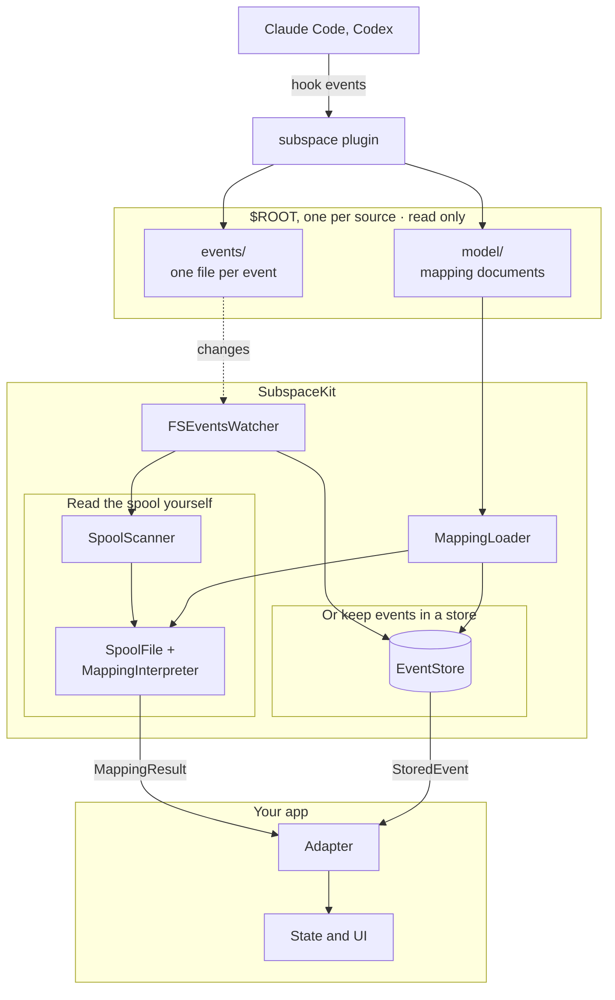
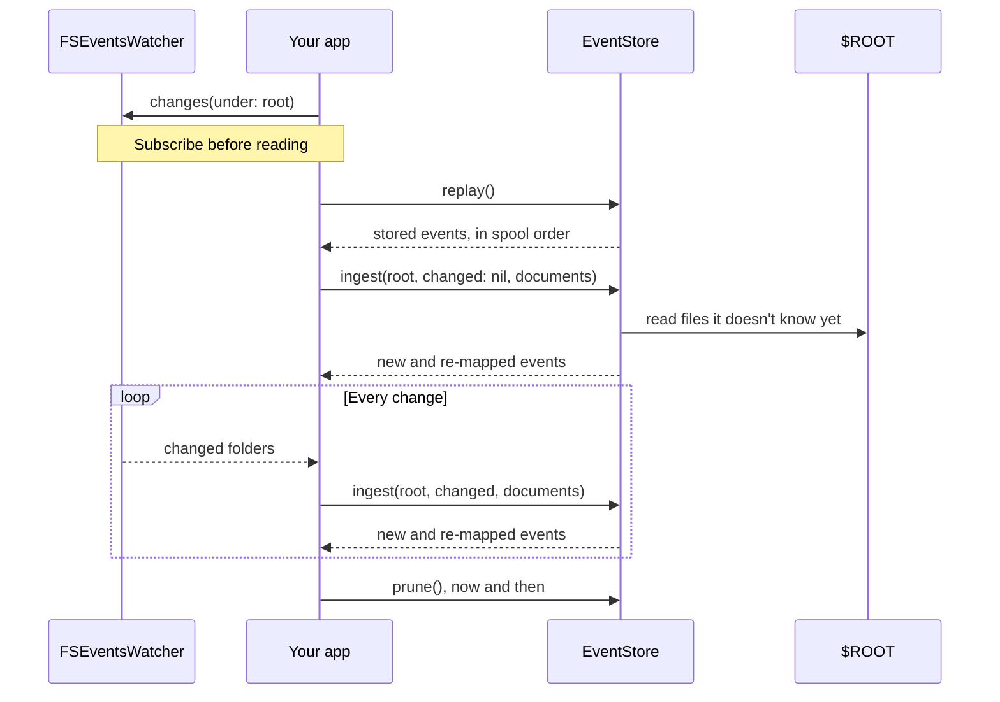

# SubspaceKit

SubspaceKit lets Swift apps read the events saved by
[subspace](https://github.com/we-are-the-borg/subspace).

It provides the spool reader, mapping interpreter and event store for
[The Collective](https://github.com/we-are-the-borg/collective), its only
user. [Unimatrix Zero](https://github.com/we-are-the-borg/unimatrix-zero) is
built in Rust and ports the reader itself.
The subspace plugins save coding agents' hook events to local folders.
SubspaceKit reads those files and extracts fields in a consistent format,
so each app can build its own view of sessions, tool calls and subagents.
It can also keep the results in a database the app owns, so a restart
doesn't read every file again.

When an agent update renames or moves fields, an updated mapping can keep
the app working without an app update. The package reads mappings from
the installed plugin and ships fallback copies for Claude Code and Codex.
It uses the supported mapping with the higher revision, preferring the
plugin's copy on a tie.

SubspaceKit only reads the plugin's data. It doesn't change or delete event
files, run agent hooks or send your data anywhere. The event store writes
only to a database in a folder your app chooses.

## Use in The Collective

The package requires **macOS 15 or later** and **Swift 6.1 or later**
(Xcode 16.3), the minimum GRDB sets. Its external package dependencies are
[GRDB](https://github.com/groue/GRDB.swift), for the event store, and
[yyjson](https://github.com/ibireme/yyjson), for parsing JSON.

The package lives in The Collective's repository as its own local package,
`SubspaceKit/` next to `CollectiveKit/`, so it can be split out again should
a second Swift app need it. `CollectiveKit/Package.swift` adds it by local
path, in `dependencies`:

```swift
.package(path: "../SubspaceKit"),
```

It then lists the library in its targets' `dependencies`:

```swift
.product(name: "SubspaceKit", package: "SubspaceKit"),
```

Install the appropriate [subspace plugin](https://github.com/we-are-the-borg/subspace#install)
to receive live events from your coding agent.

## How it fits together

The subspace plugin writes every hook event of a coding agent as a file into
that agent's data folder, `$ROOT`, along with the mapping document for its
payloads. SubspaceKit reads both, and your app turns the results into its own
events. The folder layout and file format are defined in subspace's
[contract](https://github.com/we-are-the-borg/subspace/blob/main/docs/contract.md).



There are two ways to read the events. `SpoolScanner` lists the new files in
the folders the watcher reports, and you map each one yourself, as in the next
section. `EventStore` reads and maps each file once and keeps the result in a
database your app owns, so a restart doesn't read every file again.

## Read events

Pass the plugin's data folder to `SpoolScanner` and `MappingLoader`.
The scanner looks under `events/` and returns files it hasn't seen before.
`SpoolFile.parsed(from:documents:)` reads each file's envelope and applies
its source's mapping document to the payload:

```swift
import Foundation
import SubspaceKit

@MainActor
func readEvents(at root: URL, source: SourceID) -> [MappingResult] {
    var scanner = SpoolScanner(root: root)
    let mappings = MappingLoader(root: root)
    let documents: [SourceID: MappingDocument?] = [source: mappings.document(named: source.rawValue)]

    return scanner.scanAll().compactMap { file in
        guard case let .mapped(_, result) = SpoolFile.parsed(from: file, documents: documents) else {
            return nil
        }
        return result
    }
}
```

This example reads the available events once. It skips unreadable files,
files of other sources and events without a usable mapping document. For
continuous reading, keep the scanner and loader alive, start `FSEventsWatcher`
before the initial scan, then pass its changes to `scanner.scan(changed:)`.
Fetch the documents once per pass rather than per file, since each fetch
checks the plugin's mapping file. Keep each `MappingLoader` confined to one
actor.

The app supplies each source's data folder. `SubspaceRoot.resolve` applies
a user-selected folder or the `SUBSPACE_DIR` override to that default.
See subspace's [data locations](https://github.com/we-are-the-borg/subspace#what-gets-stored)
for the standard paths.

The package's boundary is `MappingResult`: the extracted core fields and
source-specific fields. Interpreting those results as app events, storing
app state and presenting a UI belong to the consuming app.

## Keep events in a store

`EventStore` keeps each event file's mapped result in an SQLite database. At
start, your app replays the stored events instead of reading every file again,
then asks the store for the files it doesn't know yet. The store never writes
to `$ROOT`: give it a path in your app's own data folder, such as Application
Support.



```swift
import Foundation
import SubspaceKit

@MainActor
func followEvents(at root: URL, source: SourceID, storeAt path: URL,
                  apply: ([StoredEvent]) -> Void,
                  replace: ([StoredEvent]) -> Void) async throws {
    // Keeps events for 30 days, going by their file's modification time.
    let store = try EventStore(path: path, maxAge: 30 * 86_400)
    let mappings = MappingLoader(root: root)

    // Asks for the documents on every pass, so a newer mapping is picked up.
    func ingest(_ changed: Set<URL>?) async throws {
        let documents: [SourceID: MappingDocument?] = [source: mappings.document(named: source.rawValue)]
        let result = try await store.ingest(root: root, changed: changed, documents: documents)
        apply(result.new)
        replace(result.remapped)
    }

    // Subscribe before reading, so nothing written in between is missed.
    let changes = FSEventsWatcher().changes(under: root)
    apply(try await store.replay())
    try await ingest(nil)
    for await changed in changes {
        try await ingest(changed)
    }
}
```

`replay()` returns the stored events of every root, in the contract's order:
file modification time, then name. Call it once at start, before any
`ingest`. An ingest that commits while the replay is about to read returns
events the replay holds as well.

`ingest` lists the spool itself: pass the folders the watcher reports, or
`nil` to list every day. It returns the events of files the store didn't know
as `new`. When the mapping changed since the last ingest, for example through
a newer mapping document or other `excluding` fields, it also re-maps the
events it stored before, as long as their file is still in the spool, and
returns them as `remapped`. Each one replaces the
event your app got earlier for the same root, day and name. If your state
can't replace an event, rebuild it from `replay()` instead.

`excluding` drops fields per source from the mapped results before they are
stored, for example large tool output your app never reads. Events of a
source without a mapping document keep their payload, so the store maps them
once the source has one, even after their file left the spool. Files that
aren't a valid envelope are skipped; files that can't be read are retried by
the next `ingest`.

`maxAge` is your app's retention. The store neither reads nor stores files
older than that, and `prune()` deletes stored events that have passed it.
Set the property when the user changes the retention.

A damaged database is moved aside as `<path>.corrupt` when the store opens,
and the next `ingest` fills a new one from the files still in the spool.
Several processes may share one database, for example a Debug and a Release
build of your app; they take turns writing. Give all of them the same
documents, `excluding` fields and package version.

## About this repository and me

I build subspace and this package with help from Claude Code and Codex.
I review everything the agents write and test the code before releasing it.

To borrow a line from the agents: I can make mistakes.
You're welcome to read the code, question a decision or point out a bug.

## Building an app or contributing

Start with the subspace [contract](https://github.com/we-are-the-borg/subspace/blob/main/docs/contract.md)
for the folder layout, event format and rules for reading the data. The
[mapping documentation](https://github.com/we-are-the-borg/subspace/blob/main/docs/model.md)
defines how fields are extracted from each agent's payloads. Those contracts
live in subspace; this package implements their Swift consumer.

Run the package tests from the repository root:

```sh
cd SubspaceKit && swift test
```

For golden-file conformance, bundled-mapping checks and round trips over
subspace's captured payloads, also check out the subspace development
repository at `we-are-the-borg/subspace` next to this repository's owner
folder (`../../we-are-the-borg/subspace` from the repository root), or
point the tests to an existing checkout:

```sh
cd SubspaceKit && SUBSPACE_DEV_DIR=/path/to/subspace swift test
```

Without that checkout, those checks are reported as skipped. The remaining
tests still run. The conformance tests compare the Swift interpreter's
output with subspace's committed expectations from captured agent payloads.

Keep the package independent of any particular app. Sources are open string
identifiers, and app-specific adapters and state stay in the app. When
changing the API, run `CollectiveKit`'s tests as well.

## License

SubspaceKit is released under the MIT License, the same as The Collective. See the [LICENSE](../LICENSE) in the repository root.
